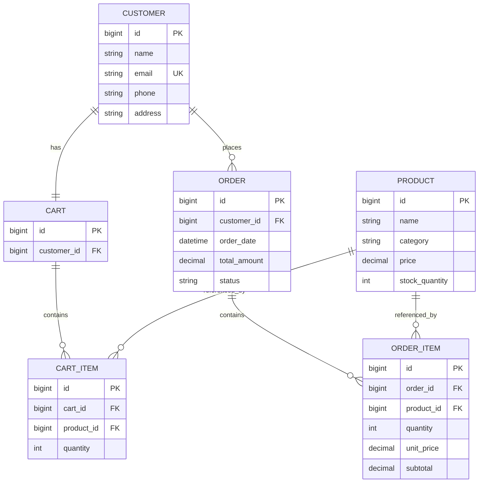

# Shopping Cart and Order Management System

A robust console-based CLI application built with **Java 17**, **Maven**, **Jakarta Persistence API (JPA)**, **Hibernate ORM**, and **MySQL**.

---

## Features

- **Product Management**: Add, view, search (by name/category), update details, and safely delete products.
- **Customer Management**: Register customers with unique email validation, search directory, and update customer profiles.
- **Shopping Cart**: Add products with real-time stock validation, update item quantities, remove items, and display formatted cart receipts.
- **Atomic Checkout**: Validates stock across all items, computes `BigDecimal` order totals, deducts inventory, records immutable historical purchase prices, creates order items, and empties the cart in a single database transaction.
- **Order Management & Cancellation**: View order receipts, inspect customer purchase history, and cancel eligible orders with automatic stock restoration and protection against duplicate restoration.
- **Inventory Management**: Filter low-stock products against customizable thresholds and restock product inventory.
- **Business Reports**: Overview dashboard tracking total cataloged products, registered customers, orders placed, and gross sales revenue.

---

## Tech Stack & Architecture

- **Language**: Java 17+
- **Build Tool**: Apache Maven
- **ORM / Persistence**: Hibernate ORM 6.6.1.Final, Jakarta Persistence API 3.1.0
- **Database**: MySQL 8.x
- **Database Driver**: MySQL Connector/J 8.3.0
- **Design Pattern**: 3-Tier Layered Architecture (Entities -> DAOs -> Services -> CLI)

---

## Entity Relationship Overview



---

## Project Structure

```
Shopping_cart_jpa/
├── pom.xml
├── .gitignore
├── README.md
└── src/
    └── main/
        ├── java/
        │   └── org/
        │       └── example/
        │           ├── Main.java
        │           ├── entity/
        │           │   ├── Cart.java
        │           │   ├── CartItem.java
        │           │   ├── Customer.java
        │           │   ├── Order.java
        │           │   ├── OrderItem.java
        │           │   └── Product.java
        │           ├── dao/
        │           │   ├── CartDAO.java
        │           │   ├── CustomerDAO.java
        │           │   ├── OrderDAO.java
        │           │   └── ProductDAO.java
        │           ├── service/
        │           │   ├── CartService.java
        │           │   ├── CustomerService.java
        │           │   ├── OrderService.java
        │           │   └── ProductService.java
        │           └── util/
        │               └── JPAUtil.java
        └── resources/
            └── META-INF/
                └── persistence.xml
```

---

## Getting Started

### Prerequisites

- Java Development Kit (JDK) 17 or higher
- Apache Maven 3.8+
- MySQL Server 8.x running locally on port `3306`

### Configuration

Open `src/main/resources/META-INF/persistence.xml` and update your MySQL username and password:

```xml
<property name="jakarta.persistence.jdbc.url" value="jdbc:mysql://localhost:3306/shopping_cart_db?createDatabaseIfNotExist=true&amp;useSSL=false&amp;allowPublicKeyRetrieval=true&amp;serverTimezone=UTC"/>
<property name="jakarta.persistence.jdbc.user" value="root"/>
<property name="jakarta.persistence.jdbc.password" value="YOUR_MYSQL_PASSWORD"/>
```

> **Note**: `createDatabaseIfNotExist=true` and Hibernate's `hbm2ddl.auto=update` will automatically create the `shopping_cart_db` database and all required tables upon first launch.

---

## Build & Execution

### 1. Compile the Project

```bash
mvn clean compile
```

### 2. Run the Application

```bash
mvn exec:java -Dexec.mainClass="org.example.Main"
```

---

## CLI Menu Navigation

```text
==================================================
   SHOPPING CART AND ORDER MANAGEMENT SYSTEM
==================================================
1. Product Management
2. Customer Management
3. Shopping Cart
4. Place Order
5. Order Management
6. Inventory Management
7. Reports
0. Exit
==================================================
```
